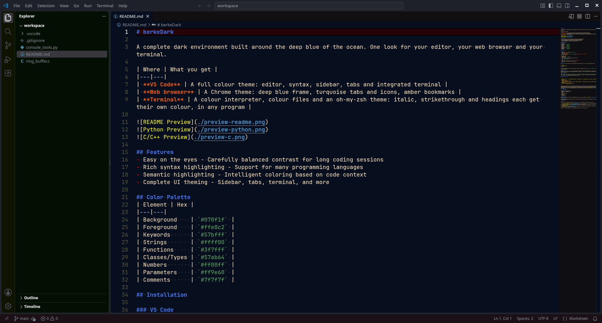
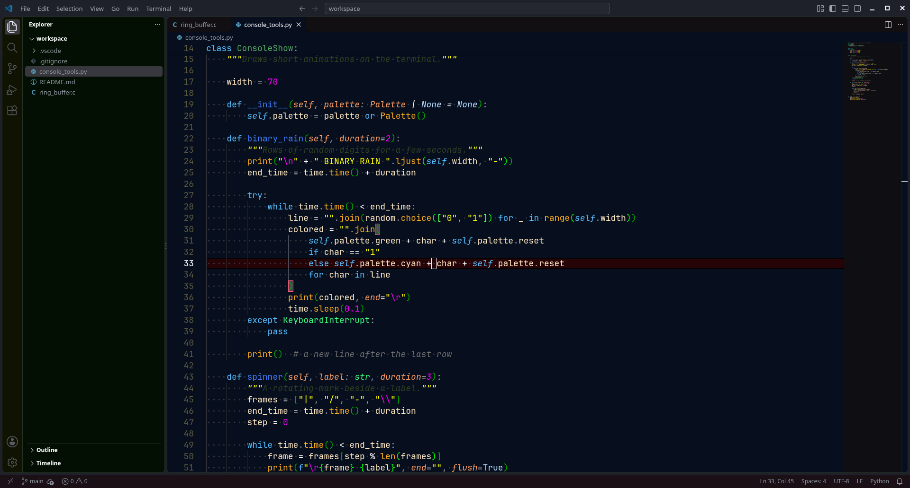
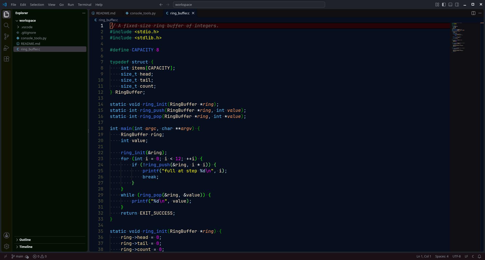

# berkeDark

A complete dark environment built around the deep blue of the ocean. One look for your editor, your web browser, your terminal and the AI tools you run in it.

| Where | What you get |
|---|---|
| **VS Code** | A full colour theme: editor, syntax, sidebar, tabs and integrated terminal |
| **Web browser** | A Chrome theme: deep blue frame, turquoise tabs and icons, amber bookmarks |
| **Terminal** | A colour interpreter, colour files and an oh-my-zsh theme: italic, strikethrough and headings each get their own colour, in any program |
| **AI tools** | Claude Code, Qwen Code, Codex and Grok in the same colours: replies, code, diffs and command lines |





## Features
- Easy on the eyes - Carefully balanced contrast for long coding sessions
- Rich syntax highlighting - Support for many programming languages
- Semantic highlighting - Intelligent coloring based on code context
- Complete UI theming - Sidebar, tabs, terminal, and more

## Color Palette
| Element | Hex |
|---|---|
| Background    | `#070f1f` |
| Foreground    | `#ffe8c2` |
| Keywords      | `#57bfff` |
| Strings       | `#ffff00` |
| Functions     | `#3f7fff` |
| Classes/Types | `#57ab64` |
| Numbers       | `#ff00ff` |
| Parameters    | `#ff9e60` |
| Comments      | `#707070` |

## Installation

berkeDark is a thing that fixes every surface on its own: where a tool gives a theme no role, berkeDark
supplies the remedy (its colour interpreter in the terminal, a theme file, a setting).

### One command

On Linux, from this folder (needs Python 3.11 or later; the terminal part also needs clang and runs on Linux only):

```sh
./berkedark install                 # everything: terminal (foot and the colour interpreter), claude, qwen, codex, grok, ohmyzsh
./berkedark install qwen codex      # only these
./berkedark install --dry-run       # say what would change, change nothing
./berkedark status                  # what is installed, file by file
./berkedark uninstall               # put every file back as it was
```

It keeps each file it touches as it was, once, in `~/.local/state/berkeDark`, the first time it changes it.
In a tool's settings file it changes only berkeDark's own keys (Claude Code's `theme` and `tui`, Qwen Code's
`ui.theme`, Codex's `[tui] theme`, Grok's `[ui] theme` and `[features] terminal_theme`, oh-my-zsh's
`ZSH_THEME`, the include line in foot's `foot.ini`) and leaves every other line, its line ends (CRLF stays
CRLF) and its mode; JSON keeps the file's indentation, though an object written on one line inside a
spread-out file comes out spread out. A file it cannot edit safely (JSON with comments, a key written another
way, a file that is not UTF-8 or is read-only) it leaves alone and says what to set. A file reached through a
symbolic link (stow, chezmoi) is written where the link points, and the link stays; a file with hard links is
written in place. It checks what it wrote (valid JSON and TOML, no empty colour in Qwen Code's theme, the
theme inside your home folder where Qwen Code requires it, foot's `--check-config`). Running it again changes
nothing.

`uninstall` takes berkeDark out again. A file berkeDark placed goes, and a file it replaced comes back. In a
settings file only berkeDark's keys go back to what they were, so what you or the tool wrote there since
(Codex's project trust, a sign-in, a model) stays; a key you changed yourself after the install stays as you
set it. A settings file berkeDark made goes only when nothing else is left in it. When a file was untouched
since the install, it comes back byte for byte. Before it changes a file that changed after the install, it
saves the file beside it as `<file>.berkeDark-before-uninstall-<date>-<time>`. A file it cannot put back is
named, the others are still done, and running `uninstall` again finishes the job.

For foot, berkeDark's include (`~/.config/foot/berkeDark.ini`) carries only its colours, its cursor and the
line that starts your shell inside the colour interpreter: the `shell=` of your `foot.ini`, else `$SHELL`,
else `/bin/sh`, started plainly when the interpreter is missing. Your font, padding, scrollback and the rest
stay yours. Run `install` again after you change `shell=` in `foot.ini`. A `foot.ini` that berkeDark has to
create starts with an include of the system's (`/etc/xdg/foot/foot.ini`), so that it hides nothing.

The patch for Qwen Code's ```diff blocks changes Qwen Code's own files, so it is never part of `install`: it
is a step of its own, `./berkedark qwen-diff-patch` (see `cli/README.md`).

### Your own colours

```sh
./berkedark settings                # creates ~/.config/berkeDark/berkeDark.toml with commented examples
```

In that file you can change a colour of berkeDark's palette, or the colour of one class (what a colour is
used for, from `pool/pool.json`):

```toml
[palette]
cream = "#fff0d6"                              # the text colour, everywhere

[roles]
"prose.number" = { fg = "pink" }               # numbers standing alone in a reply
"chat.user.input.text" = { fg = "#00ff00" }    # what you type in Claude Code
```

`./berkedark install` then writes every berkeDark file from the pool with your changes and installs them.
Remove a line to go back to berkeDark's own colour.

### VS Code
1. Open **Extensions** sidebar (`Ctrl+Shift+X`)
2. Search for `berkeDark`
3. Click **Install**
4. Open Command Palette (`Ctrl+Shift+P`) and select **Preferences: Color Theme**
5. Select **berkeDark**

From a VSIX file:
1. Download the `.vsix` file
2. Open VS Code
3. Press `Ctrl+Shift+P` and type "Install from VSIX"
4. Select the downloaded file

### Web browser
1. Open `chrome://extensions` and turn on **Developer mode**
2. Click **Load unpacked**
3. Select the `browser` folder of this repository

### Terminal
The `terminal` folder holds the colour interpreter and the colour files. It is plain C and needs only clang:

```sh
cd terminal
sh build.sh install
berkeDark
```

Every program started from that shell then shows its styles in berkeDark's colours. See `terminal/README.md` for running it in every new window.

### Claude Code
On Linux, `sh terminal/install.sh` gives Claude Code's full-screen interface the berkeDark look. It changes Claude Code's theme and display settings and keeps a backup of what it replaces; `terminal/README.md` says what it does, what was tested and how to remove it.

### Qwen Code, Codex, Grok
The `cli` folder holds berkeDark's theme for Qwen Code and for Codex, and the one setting that gives Grok the terminal's colours. `cli/README.md` says where each file goes and what each tool can show.

### oh-my-zsh
Copy `terminal/oh-my-zsh/berkeDark.zsh-theme` to `~/.oh-my-zsh/custom/themes/` and set `ZSH_THEME="berkeDark"` in `~/.zshrc`. Before each command it shows who you are, the machine, the folder, the git branch and the date and time. The line starts with `#`, so it does nothing if you copy and run it.

## Recommended Settings

```json
{
  "editor.fontFamily": "'JetBrainsMono Nerd Font', 'JetBrains Mono', 'Cascadia Mono', Consolas, Menlo, 'DejaVu Sans Mono', monospace",
  "editor.fontSize": 14,
  "editor.fontLigatures": true,
  "terminal.integrated.fontFamily": "Monaco, 'Terminess Nerd Font', 'Cascadia Mono', Consolas, 'DejaVu Sans Mono', monospace",
  "editor.cursorBlinking": "blink",
  "editor.cursorSmoothCaretAnimation": "on"
}
```

These are VS Code settings (`settings.json`). The two cursor settings change only the cursor of VS Code's
editor. A terminal's cursor is set in the terminal (foot: `[cursor]` in `foot.ini`); the cursor Qwen Code draws
is made to give way to it by the terminal's colour interpreter (see `terminal/README.md`).

VS Code skips a font that is not installed and takes the next one, so these lists work on every system. The editor prefers JetBrainsMono Nerd Font, then plain JetBrains Mono; on macOS it then has Menlo. The terminal prefers Monaco on macOS, then Terminess Nerd Font. Without those, both use what the system already has: Cascadia Mono or Consolas on Windows and DejaVu Sans Mono on most Linux systems. JetBrainsMono and Terminess Nerd Font are free from [Nerd Fonts](https://www.nerdfonts.com/font-downloads).

## Language Support

Optimized syntax highlighting for:
- JavaScript / TypeScript
- Python
- C / C++
- HTML / CSS / SCSS
- JSON / YAML
- Markdown
- And many more...

## One source
Every colour here comes from one file, `pool/pool.json`: the colours by name and the things that use them. The theme, the browser theme, the terminal's files, the AI tools' themes and the colour codes in this text are written from it by `pool/tools/generate.py`, so a colour is decided once and looks the same everywhere. `pool/README.md` explains it.

## Contributing
Found an issue or want to suggest an improvement? Open an issue or pull request on [GitHub](https://github.com/BerkeGulmen/berkeDark).

By sending a pull request you agree that your contribution may be distributed under all of berkeDark's licenses, including the commercial one.

## Licensing

Copyright (c) 2024-present Berke GÜLMEN. From version 1.1.0 on, berkeDark is offered under your choice of:

1. **[PolyForm Noncommercial 1.0.0](LICENSE-NONCOMMERCIAL.md)**: free for personal use, study, research and hobby projects, and for charities, schools, public research bodies and government institutions.
2. **[PolyForm Internal Use 1.0.0](LICENSE-INTERNAL-USE.md)**: free for the internal operations of your company, so you can use berkeDark at work.
3. **[Commercial license](LICENSE-COMMERCIAL.txt)**: needed to sell berkeDark or to include it in a product, a service or a theme pack. Contact: berkegulmen at outlook dot com

Versions up to and including 1.0.11 were released under the AGPL-3.0 and stay under it.
