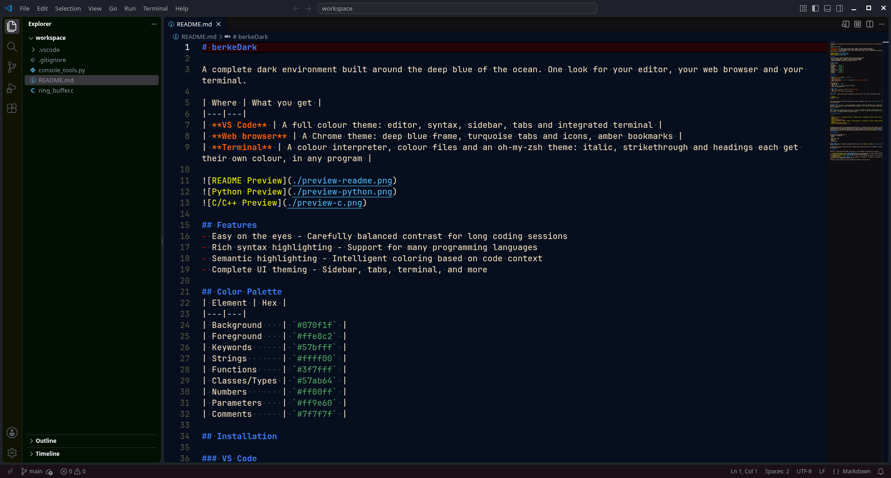
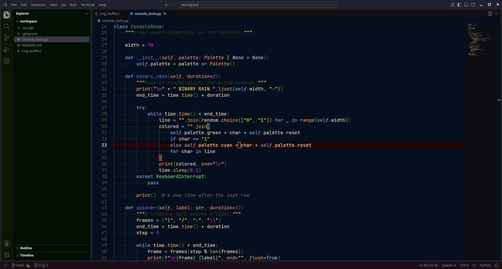
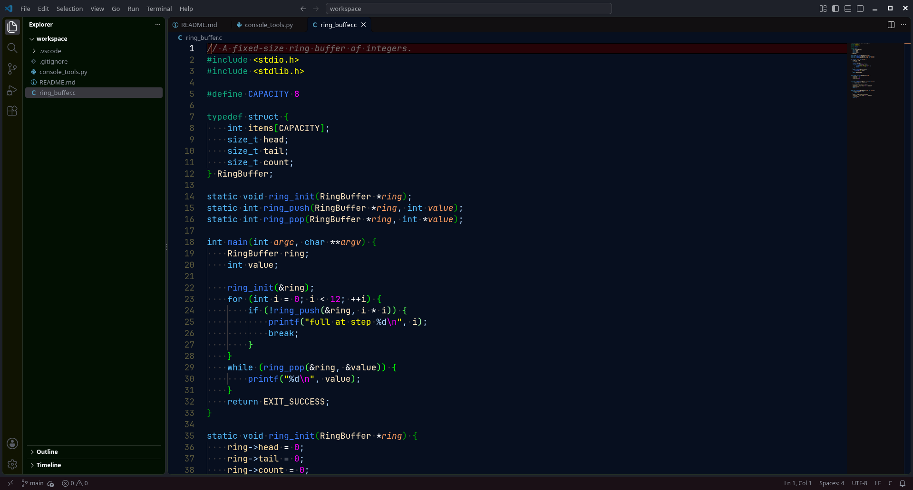

# berkeDark

A complete dark environment built around the deep blue of the ocean. One look for your editor, your web browser and your terminal.

| Where | What you get |
|---|---|
| **VS Code** | A full colour theme: editor, syntax, sidebar, tabs and integrated terminal |
| **Web browser** | A Chrome theme: deep blue frame, turquoise tabs and icons, amber bookmarks |
| **Terminal** | A colour interpreter, colour files and an oh-my-zsh theme: italic, strikethrough and headings each get their own colour, in any program |






## Features
- Easy on the eyes - Carefully balanced contrast for long coding sessions
- Rich syntax highlighting - Support for many programming languages
- Semantic highlighting - Intelligent coloring based on code context
- Complete UI theming - Sidebar, tabs, terminal, and more

## Color Palette
| Element | Hex |
|---|---|
| Background    | `#070f1f` |
| Foreground    | `#ffe8c2` |
| Keywords      | `#57bfff` |
| Strings       | `#ffff00` |
| Functions     | `#3f7fff` |
| Classes/Types | `#57ab64` |
| Numbers       | `#ff00ff` |
| Parameters    | `#ff9e60` |
| Comments      | `#7f7f7f` |

## Installation

### VS Code
1. Open **Extensions** sidebar (`Ctrl+Shift+X`)
2. Search for `berkeDark`
3. Click **Install**
4. Open Command Palette (`Ctrl+Shift+P`) and select **Preferences: Color Theme**
5. Select **berkeDark**

From a VSIX file:
1. Download the `.vsix` file
2. Open VS Code
3. Press `Ctrl+Shift+P` and type "Install from VSIX"
4. Select the downloaded file

### Web browser
1. Open `chrome://extensions` and turn on **Developer mode**
2. Click **Load unpacked**
3. Select the `browser` folder of this repository

### Terminal
The `terminal` folder holds the colour interpreter and the colour files. It is plain C and needs only clang:

```sh
cd terminal
sh build.sh install
berkeDark
```

Every program started from that shell then shows its styles in berkeDark's colours. See `terminal/README.md` for running it in every new window.

### oh-my-zsh
Copy `terminal/oh-my-zsh/berkeDark.zsh-theme` to `~/.oh-my-zsh/custom/themes/` and set `ZSH_THEME="berkeDark"` in `~/.zshrc`. Before each command it shows who you are, the machine, the folder, the git branch and the date and time. The line starts with `#`, so it does nothing if you copy and run it.

## Recommended Settings

```json
{
  "editor.fontFamily": "'JetBrains Mono', 'Ubuntu Mono'",
  "editor.fontSize": 14,
  "editor.fontLigatures": true,
  "terminal.integrated.fontFamily": "'Fira Mono', 'Ubuntu Mono'",
  "editor.cursorBlinking": "blink",
  "editor.cursorSmoothCaretAnimation": "on"
}
```

## Language Support

Optimized syntax highlighting for:
- JavaScript / TypeScript
- Python
- C / C++
- HTML / CSS / SCSS
- JSON / YAML
- Markdown
- And many more...

## Contributing
Found an issue or want to suggest an improvement? Open an issue or pull request on [GitHub](https://github.com/BerkeGulmen/berkedark-vscode).

By sending a pull request you agree that your contribution may be distributed under all of berkeDark's licenses, including the commercial one.

## Licensing

Copyright (c) 2024-present Berke GÜLMEN. From version 1.1.0 on, berkeDark is offered under your choice of:

1. **[PolyForm Noncommercial 1.0.0](LICENSE-NONCOMMERCIAL.md)**: free for personal use, study, research and hobby projects, and for charities, schools, public research bodies and government institutions.
2. **[PolyForm Internal Use 1.0.0](LICENSE-INTERNAL-USE.md)**: free for the internal operations of your company, so you can use berkeDark at work.
3. **[Commercial license](LICENSE-COMMERCIAL.txt)**: needed to sell berkeDark or to include it in a product, a service or a theme pack. Contact: berkegulmen at outlook dot com

Versions up to and including 1.0.11 were released under the AGPL-3.0 and stay under it.
